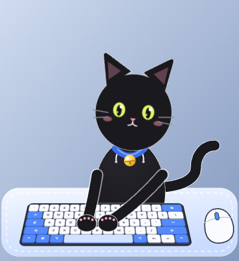
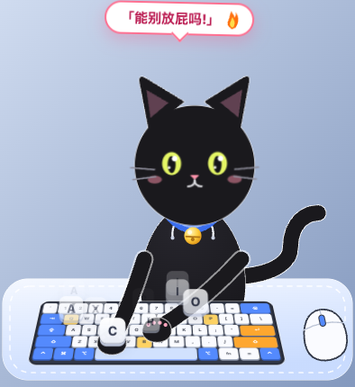
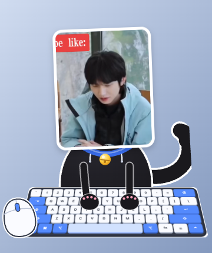

# Cyberpet · 白小纯头身分离桌宠

一只趴在键盘上陪你打字的小黑猫，顶着一颗真人抠出来的白小纯脑袋。头和身子是分开的，脑袋会自己一晃一晃。
Windows / macOS 通用，参考抖音上流行的「头身分离桌宠」做的白小纯版。

| 待机（透明背景） | 触发「能别放屁吗!」 | 视频头像（循环播放） |
| --- | --- | --- |
|  |  |  |

身子有 5 种：小黑猫 / 蓝白猫 / 卫衣人偶 / **橘猫 / 奶黄猫**。动作不是死的：姿态由不同频率的弹簧驱动
（头、脊柱、挤压、尾根、尾尖互不同步），敲键盘、生气、被摸时会「踢」一下尾巴；发呆几秒还会随机歪头、
张望、抖耳朵、伸懒腰、挪窝（这套思路借鉴了 [KuroCat](https://github.com/qianyiai/KuroCat)，代码是自己的实现）。
面板里除了头的大小，还有**整个桌宠的大小**滑块（60%–150%，右下角保持不动）。

## 能做什么

| 你做什么 | 桌宠的反应 |
| --- | --- |
| 直接敲键盘（任何 App 里都算） | 猫爪跟着敲，弹出按键气泡，键盘上对应的键会亮，播放键盘音效 |
| 敲得飞快 | 嫌你吵，触发「能别放屁吗!」 |
| 移动鼠标 / 滚轮 | 伸出爪子去抓旁边的鼠标 |
| 敲一下脑袋 | 逐渐暴躁、狂敲键盘；台词开关打开时显示「能别放屁吗!」，导入了配音/原声还会出声 |
| 按住脑袋滑动 | 摸头：脑袋跟着手歪，冒爱心，呼噜声 |
| 拖动身子 / 键盘 / 桌垫 | 挪位置（会记住） |

控制面板里还能：

- **换身子**：小黑猫身（默认）/ 蓝白小猫身 / 橘猫身 / 奶黄猫身
- **换头**：内置 Q 版猫头（默认）；可以选**图片**（PNG / JPG / GIF / 动态 PNG）或 ⌘V / Ctrl+V 粘贴。GIF / 动态 PNG 平时停在**首帧**，生气触发时才播放动画并与声音同步；「还原默认头像」一键回到 Q 版猫头
- **键鼠方向**：**反向（默认，鼠标在右）** / 正向——正向时键盘转半圈朝向小猫、鼠标挪到左边也朝内，左右爪的分工跟着视觉位置自动换
- **扩展键兜底**：小键盘数字、F 键、方向键等键盘图上没有的键，爪子自动落到主键区对应/就近的位置，左右爪按基准键分工
- **鼠标左右键反馈**：按住左键 / 右键时鼠标对应半边会持续高亮下压，松开恢复
- **台词开关「能别放屁吗」**：独立可选中 / 取消的按钮（默认关）；开着时敲脑袋显示台词，两种状态都会逐渐暴躁狂敲键盘
- **头大小**、**贴纸白边**、**按键气泡**、**键盘音效**
- **轴体音效**：麻将音 / 青轴 / 木鱼 / 奶猫爪（全部实时合成，不带音频文件）；另有**音效总开关**和**音量**滑块（控制键盘音、生气、喵、呼噜等合成音；导入配音不受它影响）
- **桌面**：**蓝白桌面（默认）** / 透明（只有键盘和鼠标） / 暗夜桌面 / 无道具
- **自动隐私保护**：见下方「隐私」一节
- **配音**：导入 mp3 / m4a / wav，生气触发时播放；没有导入就用合成音效

## 安装

成品在 `dist/`（构建产物），同一版本 7 个安装包，按需选：

| 文件 | 适合 |
| --- | --- |
| `BaiXiaoChunPet-2.0.0-mac-arm64.dmg` | Apple 芯片 Mac（推荐，双击挂载后拖进应用程序；从安装包启动时会先提示移入「应用程序」） |
| `BaiXiaoChunPet-2.0.0-mac-arm64.zip` | Apple 芯片 Mac，解压即用 |
| `BaiXiaoChunPet-2.0.0-mac-x64.dmg` / `.zip` | Intel 芯片的 Mac（自动隐私探测器的 Intel 版尚未随包提供，开启保护会保守遮蔽并提示） |
| `Cyberpet-2.0.0-setup.exe` | Windows 10 / 11，标准安装器（可自选目录、带卸载） |
| `Cyberpet-2.0.0-portable.exe` | Windows 免安装：单个文件，双击就跑，不写注册表 |
| `BaiXiaoChunPet-2.0.0-win-x64.zip` | Windows，解压出文件夹直接运行里面的 exe |

体积说明：基于 Electron，安装后约 660MB、运行内存约 150–300MB；程序完全离线，不联网、无遥测。

## 源码仓库

- GitHub：https://github.com/ChrisonLeon/Cyberpet
- Gitee（国内下载快）：https://gitee.com/chrison/Cyberpet

把 GitHub 仓库推上去之后，Gitee 上用「从 GitHub/GitLab 导入仓库」功能（https://gitee.com/projects/import/url）填 GitHub 地址一键同步即可，之后每次想同步再点一次「强制同步」。
如果想要自动同步，可以在 GitHub 仓库 Settings → Secrets 里配一个 Gitee 的私人令牌，我再加一条 CI 任务自动推送镜像。

### macOS

1. 打开 DMG，把「Cyberpet」拖进「应用程序」。
2. 第一次打开：这个 App 没有 Apple 开发者证书，系统可能会拦。右键点 App →「打开」；
   如果没有这个选项，去 系统设置 → 隐私与安全性 → 拉到底部「安全性」→「仍要打开」。
3. **授权「辅助功能」**（必须，否则收不到你的键盘鼠标）：第一次启动会弹系统提示，
   到 系统设置 → 隐私与安全性 → 辅助功能 里打开「Cyberpet」。授权后程序会自动连上，不用重启。

> 重新打包或替换了 App 之后签名会变：就算辅助功能里的开关看着还是开的，系统也不认新版本——
> 在列表里把旧条目删掉（选中后点「−」）再重新添加，或点面板上的「复制修复命令」执行
> `tccutil reset Accessibility top.baixiaochun.pet` 后重启应用重新勾选。

### Windows

1. 双击 `Cyberpet-1.3.1-setup.exe` 安装（免安装场景直接双击 `...portable.exe` 或用 zip 版）。
2. 不需要任何系统权限。SmartScreen 可能提示「Windows 已保护你的电脑」→「更多信息」→「仍要运行」（没有代码签名证书的通病）。

> Windows 版 v1.3.2 修复了一个真机问题：打包时混入了 mac 编译的键鼠组件，会导致面板提示
> 「当前环境没有可用的键鼠监听组件」——**请用 v1.3.2 及以后的安装包**。如果仍提示这句，面板横幅会
> 显示具体的加载错误，把那段文字发给站长即可定位。推送代码到 GitHub 后，Actions 会在
> macOS / Windows / Ubuntu 上自动跑单元测试和冒烟测试（`.github/workflows/ci.yml`）。

## 提取素材（头像帧 / 配音）

`未命名文件夹` 里放了 5 段视频，用 `tools/extract.swift`（AVFoundation）一次性提取到 `未命名文件夹/提取库/`：
**头像帧/** 67 张（每段视频每 2 秒一帧，挑顺眼的当图片头像）、**配音/** 23 段 m4a（每 10 秒一段，挑「能别放屁吗」等片段导入配音）。
这三个目录已经预填到面板「素材」一行；以后往文件夹里加新视频，重新跑一次工具即可：

```bash
cd tools && swiftc -O -o extract extract.swift
./extract "/Users/chrison/Desktop/未命名文件夹" "/Users/chrison/Desktop/未命名文件夹/提取库" 2 10
```

更完整的提取（透明底静态抠头 / 透明底动态抠头 / 2–3 秒头部特写视频 / 按语音分段、文件名带字幕的配音）
用 `tools/media-pipeline.swift`，提取库就是这么生成的。字幕识别不准的片段在 `提取库/说明表.json` 里人工校对过：

```bash
cd tools && swiftc -O -o media-pipeline media-pipeline.swift
./media-pipeline "/Users/chrison/Desktop/未命名文件夹" "/Users/chrison/Desktop/未命名文件夹/提取库" \
  --table "/Users/chrison/Desktop/未命名文件夹/提取库/说明表.json"
```

测试与质量保障：

```bash
npm test           # 单元测试（按键标签、配音联动、设置校验、导入清理、素材）
npm run smoke      # 冒烟测试：真实启动跑 33 步 67 项断言并截图到 .smoke/
BXC_PET_PLATFORM=win32 npm run smoke   # 把展示逻辑模拟成 Windows 再跑一遍
```

推送代码到 GitHub 后，Actions 会在 macOS / Windows / Ubuntu 上自动跑这两层测试。

## 换配音

面板「更多」一行 →「导入配音」，从音频目录选一段 mp3 / m4a / wav。
导入后，敲脑袋或打字太猛时会播放它；不导入则用合成的低吼声代替。

## 隐私

- 全局键鼠监听只把「按了哪个键」「鼠标坐标」交给桌宠用来画气泡和动爪子，**不记录、不落盘、不上传**。
- **自动隐私保护**（面板开关，默认关）：
  - 检测到**密码框 / 系统安全输入** → 立即闭眼（Q 版猫头）、遮挡键盘、停掉按键映射和声音；
  - 检测到**前台全屏**或**常见录屏 / 共享软件在运行**（OBS、QuickTime、Zoom、腾讯会议类、ToDesk / 向日葵等）→ 整体自动隐藏，退出场景短暂防抖后恢复（不会覆盖你自己选的「隐藏桌宠」）；
  - 开着保护但探测器失联 / 不支持时，**保守遮蔽**并明确提示，绝不把「检测不了」当成「没有风险」。
- 边界（如实说明）：录屏识别是**运行中进程白名单**，不在名单里的录屏工具识别不到；通用录屏和自绘密码框无法保证全部识别；macOS 的系统内容保护开关（跟随同一开关）能挡住部分截图 / 录屏 API，但不能承诺「任何软件都拍不到」。
- 探测器只输出布尔结论（有没有密码框 / 全屏 / 录屏软件），不读取输入内容、窗口标题或剪贴板；源码在 `native/`。
- 所有设置存在本机：macOS 在 `~/Library/Application Support/Cyberpet/`，Windows 在 `%APPDATA%\Cyberpet\`；开发模式的配置在 `Cyberpet-dev/`，与打包版互不干扰。

## 开发

需要 Node.js ≥ 20。

```bash
# 国内网络走镜像
export ELECTRON_MIRROR=https://npmmirror.com/mirrors/electron/
export ELECTRON_BUILDER_BINARIES_MIRROR=https://npmmirror.com/mirrors/electron-builder-binaries/

npm install
# npm 11+ 默认不执行依赖的安装脚本，Electron 的二进制要手动补一次
node node_modules/electron/install.js

npm start          # 开发运行
npm run selftest   # 无人值守自测：把所有动作和造型跑一遍，截图输出到 .selftest/
npm run icons      # 重新生成应用图标 / 托盘图标（改了 SVG 素材后用）
npm run dist:mac   # 打包 macOS（arm64 + x64 的 DMG）
npm run dist:win   # 打包 Windows 安装包（在 Mac 上也能直接打）
```

### 目录结构

```
（仓库根目录）
├─ src/
│  ├─ main/         主进程：透明置顶窗口、托盘、全局键鼠钩子、设置
│  ├─ preload/      渲染进程 ↔ 主进程的桥（contextIsolation）
│  └─ renderer/
│     ├─ pet/       桌宠本体：动画引擎 + 指针交互 + 点击穿透
│     ├─ panel/     控制面板
│     └─ shared/    art.js 程序化 SVG 素材、audio.js 合成音效
├─ assets/          头图、图标
├─ tools/           图标生成、抠头工具、打包后 ad-hoc 签名
└─ docs/            截图
```

### 实现要点

- **全局键鼠**：`uiohook-napi`（自带 Win / macOS / Linux 预编译包）。macOS 上它走 `AXIsProcessTrustedWithOptions`，
  所以要的是「辅助功能」权限而不是「输入监控」。
- **不抢焦点**：桌宠窗口是不可聚焦的面板，点它不会把你正在打字的 App 顶掉。
- **点击穿透**：透明区域 `setIgnoreMouseEvents(true, { forward: true })` 让鼠标落到桌面，
  渲染层用 `elementFromPoint` 判断指针是否落在实体上，动态切换。
- **贴纸白边**：照片头用「压成白色剪影 + 一串 drop-shadow」的 CSS 滤镜实现，矢量部分画两层（白色底层 + 彩色层）。
- **省电**：没有动静时降到约 30 帧，有输入立刻回到 60 帧。

### 换头图

内置头图在 `assets/heads/bxc-default.png`。想换成别的照片，用 `tools/headcut.swift` 抠：

```bash
cd tools && swiftc -O -o headcut headcut.swift
./headcut 输入.jpg ../assets/heads/bxc-default.png 2600 677 0.5 0.08 1.1 2.4 1 0.12
```

参数依次是：最长边、输出高度、脖子半宽（按脸宽的比例）、下巴以下保留、两侧斜率、最大半宽、去毛边像素、下颌弧度。
选正面、头发和背景分得开、手不在脸旁边的照片效果最好。

## 作者信息

默认不显示。要展示的话，把 `src/main/main.js` 顶部 `AUTHOR` 常量里的 `show` 改成 `true`：

```js
const AUTHOR = {
  show: true,
  name: '凉拌卡皮巴拉',
  douyin: 'https://v.douyin.com/sAG1aUn2fRE/',
  douyinId: 'Chrison_Leon',
  github: 'https://github.com/ChrisonLeon/Cyberpet',
  gitee: 'https://gitee.com/chrison/Cyberpet',
};
```


## 素材与版权

- 白小纯头图取自 TJB 队服定妆照（百度百科词条配图 / TJB 俱乐部物料），与粉丝站的 `public/assets/img/player-peace.jpg` 同源。
  图片版权归原作者及俱乐部所有，仅作粉丝交流，如需下架请联系。
- 代码仅供个人学习交流。

## 支持作者

如果 Cyberpet 给你带来了快乐，欢迎「为爱发电」请作者（凉拌卡皮巴拉，抖音 @Chrison_Leon）喝杯奶茶；
控制面板底部「支持」一行可随时找到收款码（点击放大）。

<p>
  
  
</p>

## 发布新版（手动更新源）

客户端「支持 → 检查更新」读取仓库根目录的 `latest.json`（优先 Gitee raw，GitHub raw 兜底）。发布流程：

1. `package.json` 升版本 → `npm run dist:mac` / `npm run dist:win`（记得带 npmmirror 环境变量）
2. 在 GitHub Releases 上传 `dist/` 里的 zip（mac）与 setup.exe/portable（win），Release 标签格式 `v2.5.0`
3. 更新仓库根目录 `latest.json`（version / notes / urls 指向新资产），提交并推送 GitHub
4. Gitee 镜像同步后，已装客户端「检查更新」即可发现新版
5. 若在 Gitee 也发布了 Release 并上传资产，可把 Gitee 直链加到对应 `urls` 数组最前面，国内下载更快

macOS：下载 zip → 解压校验 → 退出应用 → 自动替换 → 自动重启；Windows：下载 setup.exe → 静默安装。
设置、头像、配音存放在用户目录，两种方式都自动保留。便携版与未装进「应用程序」的 mac 只提供「打开下载页」手动更新。

## 已知限制

- **输入卡死防护**：键鼠监听使用 macOS 全局事件钩子。v2.7.0 起改为独立助手进程的**被动监听**（listen-only tap）——无权修改或吞掉任何事件，从机制上杜绝「钩子停摆导致全系统鼠标键盘堵死」；助手崩溃会自动拉起，被动钩子即使失效也只是桌宠不动，不会影响你的输入。托盘菜单另有「键鼠监听」应急开关。Intel Mac 上助手缺失时退回旧版主动钩子（已知有上述风险）。

- Windows 版未真机验证（CI 只覆盖代码级 + 平台模拟）；自动隐私保护的 Windows 探测器源码已交付（`native/windows/privacy-probe.cpp`），**尚未在 Windows 环境编译**——编译前开启该功能会保守遮蔽并提示。
- macOS 自动隐私探测器的 Intel（x86_64）版因本机工具链缺 Swift 兼容层未随包提供；Intel Mac 上开启保护会保守遮蔽并提示。装了完整 Xcode 后可用 `npm run build:privacy` 补齐。
- 应用曾叫「白小纯桌宠」，v1.3.1 起改名 **Cyberpet**；旧版本的设置和已导入的头像、配音会自动迁移到新目录，不用重新配置。
- macOS / Windows 都没有购买代码签名证书：首次打开要手动放行；macOS 重新打包后要重新授权辅助功能。
- 橘猫 / 奶黄两只黄猫是按常见橘白配色画的；有猫本猫的照片可以发我照着调。
